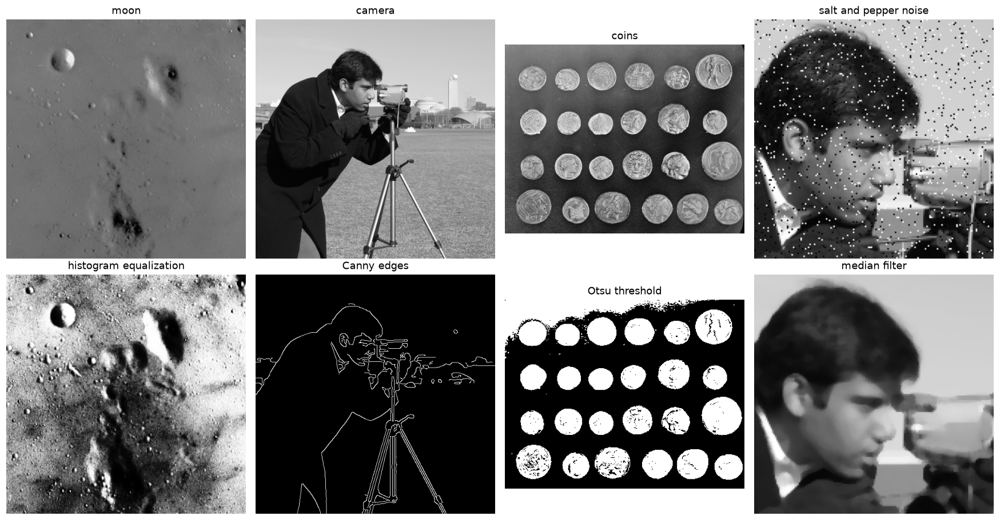

# Image Processing

[](https://github.com/anupbagale/Image_Processing/actions/workflows/ci.yml)
[](LICENSE)

Jupyter notebooks for basic digital image processing, written in Python with NumPy. Most of the
algorithms are implemented by hand first and then checked against the OpenCV or scikit-image
version of the same thing.



## Notebooks

| # | Notebook | What it covers | Colab |
|---|---|---|---|
| 1 | [Bitwise operations](notebooks/01_bitwise_operations.ipynb) | AND, OR, XOR, NOT, masking | [open](https://colab.research.google.com/github/anupbagale/Image_Processing/blob/main/notebooks/01_bitwise_operations.ipynb) |
| 2 | [Zooming](notebooks/02_zooming.ipynb) | pixel replication, bilinear interpolation | [open](https://colab.research.google.com/github/anupbagale/Image_Processing/blob/main/notebooks/02_zooming.ipynb) |
| 3 | [Contrast stretching](notebooks/03_contrast_stretching.ipynb) | min-max and percentile stretching | [open](https://colab.research.google.com/github/anupbagale/Image_Processing/blob/main/notebooks/03_contrast_stretching.ipynb) |
| 4 | [Histogram equalization](notebooks/04_histogram_equalization.ipynb) | histogram, CDF, lookup table | [open](https://colab.research.google.com/github/anupbagale/Image_Processing/blob/main/notebooks/04_histogram_equalization.ipynb) |
| 5 | [Noise](notebooks/05_noise.ipynb) | salt and pepper, Gaussian and speckle noise, PSNR, median filter | [open](https://colab.research.google.com/github/anupbagale/Image_Processing/blob/main/notebooks/05_noise.ipynb) |
| 6 | [Sobel and Prewitt](notebooks/06_sobel_and_prewitt.ipynb) | image gradient, edge strength | [open](https://colab.research.google.com/github/anupbagale/Image_Processing/blob/main/notebooks/06_sobel_and_prewitt.ipynb) |
| 7 | [Canny edge detection](notebooks/07_canny_edge_detection.ipynb) | non-maximum suppression, hysteresis | [open](https://colab.research.google.com/github/anupbagale/Image_Processing/blob/main/notebooks/07_canny_edge_detection.ipynb) |
| 8 | [Otsu thresholding](notebooks/08_otsu_thresholding.ipynb) | automatic threshold, between-class variance | [open](https://colab.research.google.com/github/anupbagale/Image_Processing/blob/main/notebooks/08_otsu_thresholding.ipynb) |
| 9 | [Entropy](notebooks/09_entropy.ipynb) | information content of an image | [open](https://colab.research.google.com/github/anupbagale/Image_Processing/blob/main/notebooks/09_entropy.ipynb) |
| 10 | [Run-length encoding](notebooks/10_run_length_encoding.ipynb) | lossless compression of text and images | [open](https://colab.research.google.com/github/anupbagale/Image_Processing/blob/main/notebooks/10_run_length_encoding.ipynb) |
| 11 | [Huffman coding](notebooks/11_huffman_coding.ipynb) | variable-length codes, comparison with entropy | [open](https://colab.research.google.com/github/anupbagale/Image_Processing/blob/main/notebooks/11_huffman_coding.ipynb) |

## Running the notebooks

The quickest way is Google Colab: use the link in the table. Everything the notebooks need is
already installed there.

To run them on your own computer you need Python 3.9 or newer:

```bash
git clone https://github.com/anupbagale/Image_Processing.git
cd Image_Processing
pip install -r requirements.txt
jupyter lab notebooks/
```

## Images

The test images come with scikit-image (`skimage.data`), so nothing has to be downloaded or
uploaded. The camera image is CC0, and the moon and coins images have no known copyright
restrictions.

## Tests

Every notebook is run from top to bottom on GitHub after each change. To do the same locally:

```bash
pip install pytest nbmake
pytest --nbmake notebooks/
```

## License

[MIT](LICENSE)
